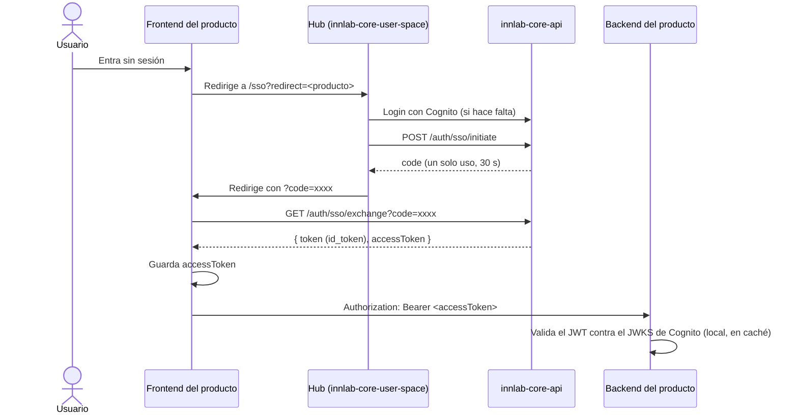

# Autenticación y SSO

📍 [InnLab](../README.md) › [InnLab Core](README.md) › **Autenticación y SSO**

> **Resumen:** el usuario inicia sesión una sola vez en el hub de Core. Para entrar a un producto, Core emite un código de un solo uso (30 s) que el producto canjea por un `accessToken`. Desde ahí, el producto valida el token localmente contra el JWKS de Cognito.

## Flujo SSO

## Lado del frontend del producto

- Una ruta (por ejemplo `/sso`) lee `?code=` de la URL, llama a `GET {VITE_CORE_API_URL}/auth/sso/exchange?code=…` y guarda el **`accessToken`**.
- Todas las llamadas al backend del producto llevan `Authorization: Bearer <accessToken>`.
- Si no hay sesión, se redirige al hub de Core. **El producto no tiene pantalla de login propia.**
- Implementación de referencia: `authService.js` de [foresight-user-space](../05-Proyectos/foresight/foresight-user-space.md).

## Lado del backend del producto

- **Guard JWT global**: todas las rutas exigen token salvo las marcadas con `@Public()` (por ejemplo `/health`).
- Validación **local** con el JWKS de Cognito, `RS256`, `issuer === COGNITO_ISSUER` y `token_use === 'access'`.
- El usuario autenticado (`@CurrentUser()`) trae `id`, `email`, `firstName` y `lastName`. **No trae empresa ni rol**: eso se pide a la [API interna](api-interna.md).
- Los datos propios del producto se filtran por el `companyId` que devuelve Core.

## Sesión

| Endpoint (Core) | Uso |
| --- | --- |
| `POST /auth/logout` | Cierre de sesión centralizado (invalida en Cognito) |
| `GET /auth/introspect` | Saber si la sesión sigue activa |

El cierre de sesión en un producto llama al logout de Core, así se cierra en todo el ecosistema.
