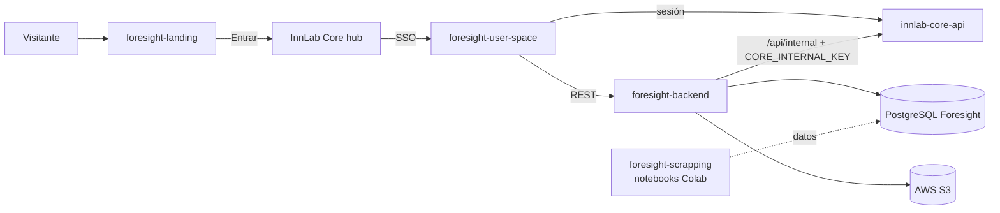

# Foresight

📍 [InnLab](../../README.md) › [Proyectos](../README.md) › **Foresight**

> _[Descripción del proyecto — la escribe el líder del proyecto.]_
>
> Lo que se ve en el código: Foresight es el producto de **vigilancia tecnológica** de InnLab. Genera informes y radares por **vertical** (fintech, agrotech, biotech…) a partir de papers, patentes y noticias recolectados por scraping. Tiene planes de suscripción y un servicio a la medida (*custom made*). El usuario entra desde el hub de InnLab Core por SSO.

## Ficha

| | |
| --- | --- |
| Estado | 🟢 Activo |
| Repos | [foresight-backend](foresight-backend.md) · [foresight-user-space](foresight-user-space.md) · [foresight-landing](foresight-landing.md) · [foresight-scrapping](foresight-scrapping.md) |
| Stack | [NestJS](../../04-Stacks/nestjs.md) + [React + Vite](../../04-Stacks/react-vite.md) (JS) + [Python](../../04-Stacks/python-notebooks.md) |
| Auth | Cognito vía [InnLab Core](../../03-InnLab-Core/README.md) (SSO) |
| Datos | PostgreSQL propio (TypeORM) + AWS S3 para archivos |
| Despliegue | En redefinición (ver [Despliegue y CI/CD](../../01-Estandares/despliegue-y-ambientes.md)) |
| Responsable | _por definir_ |

## Arquitectura

## Reglas propias del proyecto

- **Ninguna regla general distinta a los [Estándares](../../01-Estandares/README.md).** Todo lo específico está en la página de cada repo.
- Foresight es la **integración de referencia con InnLab Core**: de su backend se extrajo [product-integration-guide](../../03-InnLab-Core/product-integration-guide.md).
- Los datos que produce `foresight-scrapping` se cargan a la BD de Foresight. **(Pendiente)** Documentar cómo (¿manual, script?).
- El usuario no se registra en Foresight: la identidad y la empresa vienen de InnLab Core.

## Ambientes

| Ambiente | user-space | backend |
| --- | --- | --- |
| Local | `http://localhost:5174` | `http://localhost:3002` |

Los ambientes desplegados se documentarán cuando se defina el nuevo estándar de despliegue.

## Repos

| Repo | Qué es | Estado |
| --- | --- | --- |
| [foresight-backend](foresight-backend.md) | API NestJS: informes, verticales, suscripciones, assets y S3 | Activo, sin tests |
| [foresight-user-space](foresight-user-space.md) | App del cliente (React JS) | Activo, sin tests |
| [foresight-landing](foresight-landing.md) | Sitio público de marketing (React JS) | Activo, `main` desincronizado de `dev` |
| [foresight-scrapping](foresight-scrapping.md) | Notebooks de recolección de papers, patentes y noticias | ⚠️ Pendiente de seguridad |
