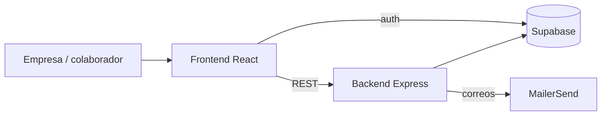

# Growinn Index (Inndex)

📍 [InnLab](../../README.md) › [Proyectos](../README.md) › **Growinn Index**

> ⚠️ **Este producto será reemplazado por [Índigo](../indigo/README.md).** Mientras tanto se mantiene tal cual: solo se corrige lo que bloquee la operación y no se invierte en refactors ni en migraciones.

> _[Descripción del proyecto — la escribe el líder del proyecto.]_
>
> Lo que se ve en el código: Inndex es una plataforma de **encuestas de diagnóstico para empresas**. La empresa carga su estructura de áreas, roles y jerarquías (operativo, táctico y estratégico), también desde Excel. Envía encuestas por correo y ve los resultados con puntajes por área y jerarquía.

## Ficha

| | |
| --- | --- |
| Estado | 🟠 En mantenimiento; se reemplazará por Índigo |
| Repos | [-Growinn-index-test](growinn-index-test.md) (monorepo: `Backend/` + `Frontend/`) |
| Stack | [Express](../../04-Stacks/express-node.md) (legado) + [React + Vite](../../04-Stacks/react-vite.md) (JS) |
| Auth | Supabase Auth. No está integrado con InnLab Core, aunque Core ya tiene reservada la key `INTERNAL_KEY_INNDEX` |
| Datos | Supabase |
| Correo | MailerSend |
| Responsable | _por definir_ |

## Arquitectura

## Reglas propias del proyecto

- El repo tiene su propia guía (`GitHubWorkflowGuide.md`). **La wiki la reemplaza**: su contenido quedó en [Git y ramas](../../01-Estandares/git-y-ramas.md), [Commits](../../01-Estandares/commits.md) e [Issues y PRs](../../01-Estandares/issues-y-pull-requests.md).
- Los cambios que sí se hagan siguen igual los estándares de ramas, commits y PR.

## Repos

- **[-Growinn-index-test](growinn-index-test.md)**: monorepo con backend y frontend.
