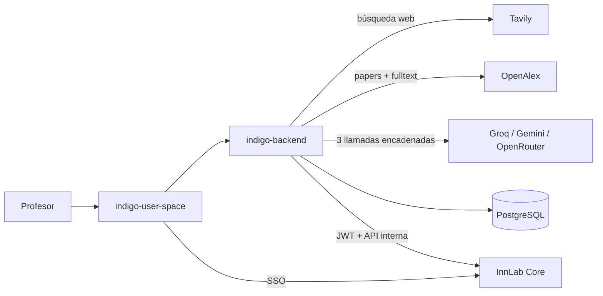

# Índigo

📍 [InnLab](../../README.md) › [Proyectos](../README.md) › **Índigo**

> _[Descripción del proyecto — la escribe el líder del proyecto.]_
>
> Lo que se ve en el código: Índigo es la plataforma de **diagnósticos organizacionales**. Un profesor experto define un tema, el sistema busca literatura (web con Tavily y papers con OpenAlex), el profesor elige las fuentes, y un LLM genera en cadena la estructura **1-3-9-45**: 1 diagnóstico → 3 macro categorías → 9 categorías → 45 ítems Likert-6. Después el diagnóstico se aplica a empresas y se recogen respuestas.

## Ficha

| | |
| --- | --- |
| Estado | 🟡 En desarrollo (inicio en sep-2026) |
| Repos | [indigo-backend](indigo-backend.md) · [indigo-user-space](indigo-user-space.md) |
| Stack | Backend [NestJS](../../04-Stacks/nestjs.md) 12 · Frontend **[Vue 3 + Vite](../../04-Stacks/vue-vite.md)** + TypeScript |
| Auth | **InnLab Core**, integrado en el backend (guard JWT) y en el frontend (SSO). Ver [Integrar un producto](../../03-InnLab-Core/integrar-un-producto.md) |
| Datos | PostgreSQL con migraciones versionadas. La base pasará al estándar institucional (en definición) |
| IA | Cadena de respaldo entre Groq, Gemini y OpenRouter (basta con una key) |
| Despliegue | Aún no desplegado (plataforma en definición). CI completo en los dos repos, con el simulacro de promoción |
| Responsable | _por definir_ |

## Arquitectura

**Pipeline** (lineal, sin agentes): búsqueda en paralelo → enriquecimiento de papers → el profesor revisa las fuentes → macros → categorías → ítems (cada paso validado con Zod) → persistencia.

## Reglas propias del proyecto

- **Toda salida del LLM se valida con un esquema Zod** antes de pasar al siguiente paso. Si una llamada falla, se reintenta solo esa, no todo el pipeline.
- Los prompts y modelos se centralizan en `generate/` y `claudeClient.ts`. Cambiar de modelo es un cambio de configuración, no de código.
- Los costos por llamada (OpenAlex Fulltext tiene precio por paper) se documentan en la página del repo.
- **El frontend es Vue + Vite, y así se queda.** Se eligió por velocidad de desarrollo, rendimiento y una curva de aprendizaje fácil para todos.
- No se suben archivos de asistentes de IA (`CLAUDE.md`, `.claude/`, specs generados). Ver [Documentación](../../01-Estandares/documentacion.md).
- **La autenticación va por InnLab Core**: el backend usa el guard y el cliente de [product-integration-guide](../../03-InnLab-Core/product-integration-guide.md), y el frontend recibe el SSO. No se construye login propio.
- **Índigo reemplazará a [Growinn Index](../growinn-index/README.md).** Los hallazgos de Growinn están documentados para no repetirlos.
- **(Pendiente)** Términos de dominio en español (`diagnosticador`, `macro_categorias`): ver [Pendientes por concretar](../../pendientes-por-concretar.md).

## Repos

- **[indigo-backend](indigo-backend.md)**: API NestJS (diagnosticador, aplicaciones, portal comercial y portal empresa), con Swagger y SonarQube Cloud. **Repo de referencia de backend.**
- **[indigo-user-space](indigo-user-space.md)**: frontend en Vue 3 + Vite + TypeScript (portal profesor y portal empresa), con Playwright. **Repo de referencia de frontend.**
