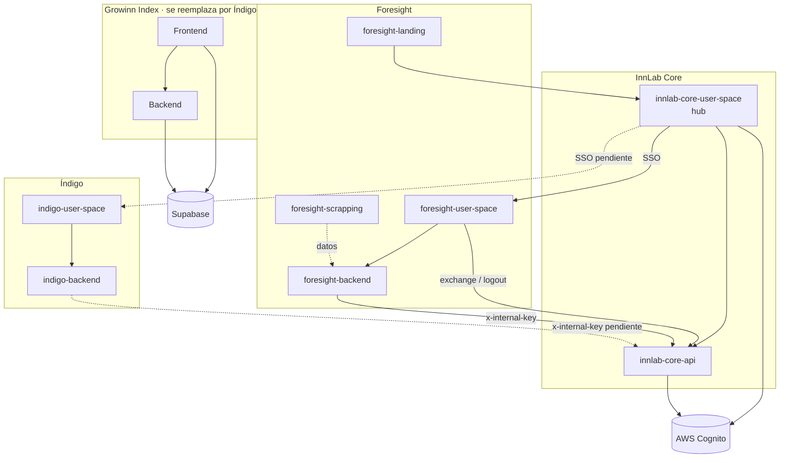

# Mapa de servicios

📍 [InnLab](../README.md) › Referencia › **Mapa de servicios**

> **Resumen:** qué repo habla con cuál y con qué credencial. **Toda integración nueva entre servicios se agrega aquí en el mismo PR que la crea.** El contrato detallado con Core está en [InnLab Core → API interna](../03-InnLab-Core/api-interna.md).

## Diagrama general

## Quién llama a Core

| Consumidor | Tipo | Credencial | Estado |
| --- | --- | --- | --- |
| foresight-user-space | Frontend → endpoints públicos de auth | Token del usuario | ✅ |
| foresight-backend | Backend → `/internal/*` | `INTERNAL_KEY_FORESIGHT` | ✅ |
| Backend de Inndex | Backend → `/internal/*` | `INTERNAL_KEY_INNDEX` | 🔑 Reservada |
| Backend de Ucorp | Backend → `/internal/*` | `INTERNAL_KEY_UCORP` | 🔑 Reservada |
| Backend de diag-irl | Backend → `/internal/*` | `INTERNAL_KEY_DIAG_IRL` | 🔑 Reservada |
| indigo-user-space / indigo-backend | Frontend + backend | Key por asignar | ⏳ Pendiente |

## Puertos locales (para correr todo a la vez)

| Servicio | Puerto |
| --- | --- |
| innlab-core-user-space | 5173 |
| foresight-user-space | 5174 |
| innlab-core-api | 3001 |
| foresight-backend | 3002 |
| product-integration-guide | 3000 |

Los ambientes desplegados se documentarán cuando se defina el estándar de despliegue.
